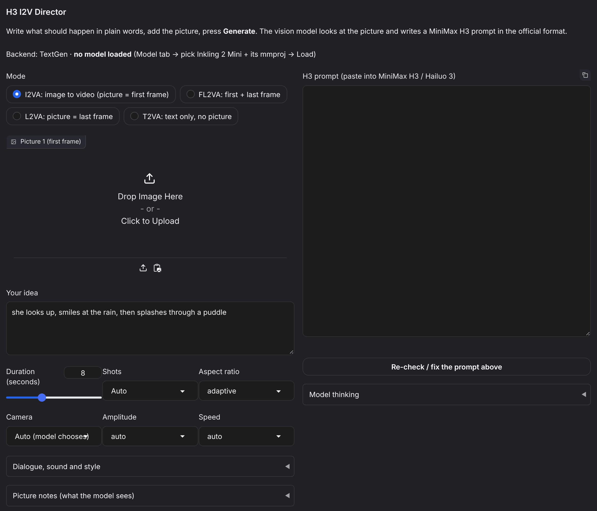

# H3 I2V Director: MiniMax H3 prompts from plain language, inside TextGen

Describe what should happen in your own words and add the picture. Inkling 2 Mini (uncensored) looks at
the picture and writes a complete **MiniMax H3 (Hailuo 3) image-to-video prompt** in MiniMax's official
format. The tab then checks and repairs the format, so the result is ready to paste.



- **Runs locally in [TextGen](https://github.com/oobabooga/textgen)** (oobabooga's text-generation-webui).
- **Vision model included:** Inkling 2 Mini reads images itself. With its `mmproj` file loaded it is
  both the prompt writer and the "eyes".
- **Official H3 format** from MiniMax's own prompt-writing guide
  ([MiniMax-AI/MiniMax-H3 → `skills/h3-prompt-writing`](https://github.com/MiniMax-AI/MiniMax-H3/tree/main/skills/h3-prompt-writing)),
  the format their own prompt rewriter (H3-Context-IR) produces.
- **Modes:** I2VA (picture = first frame), FL2VA (first + last frame), L2VA (picture = last frame),
  T2VA (text only).

## What's in this folder

| Path | What it is |
|---|---|
| `user_data/extensions/h3_i2v_director/` | The **H3 I2V Director** tab (TextGen extension) |
| `user_data/extensions/h3_i2v_director/system_prompt.md` | The H3 rules the model follows (edit to taste) |
| `user_data/instruction-templates/Inkling 2 - H3 Director.yaml` | Same rules for TextGen's normal **Chat** tab |
| `user_data/presets/H3 Director.yaml` | Sampling preset (temperature 0.8, top_p 0.95, min_p 0.05) |
| `tools/build_template.py` | Rebuilds the Chat template after you edit `system_prompt.md` |
| `tests/` | Tests for the format checker (`python -m unittest discover -s h3-i2v-promptgen/tests`) |

## Setup

You need a PC (Windows, Linux or Mac), not a phone. Inkling 2 Mini has 26 B parameters but only about
3.4 B are active per token, so it runs on a CPU, faster with a GPU. Plan for **32 GB of RAM** (or RAM +
VRAM) for a Q4_K_M file.

### 1. Install TextGen

Download the portable build for your system from
[github.com/oobabooga/textgen/releases](https://github.com/oobabooga/textgen/releases), unzip it and start
it (`textgen`, or `start_windows.bat` / `start_linux.sh` / `start_macos.sh` in the full version).
It opens at http://127.0.0.1:7860.

### 2. Add a newer llama.cpp (needed for Inkling 2)

Inkling 2 support was added to llama.cpp on 15–21 November 2026. The llama.cpp built into TextGen (v4.9)
is from June 2026 and cannot load the model yet ("unknown model architecture: inkling2").
Once TextGen ships a newer llama.cpp you can skip this step.

1. Open [github.com/ggml-org/llama.cpp/releases](https://github.com/ggml-org/llama.cpp/releases) and take
   release **b12638 or newer** (22 Nov 2026+).
2. Download the file for your machine:
   - Windows + NVIDIA: `llama-bXXXXX-bin-win-cuda-12.4-x64.zip` and `cudart-llama-bin-win-cuda-12.4-x64.zip`.
     If the CUDA zip only contains `ggml-cuda.dll`, also download `llama-bXXXXX-bin-win-cpu-x64.zip`.
   - Windows, other GPU: `...-bin-win-vulkan-x64.zip` (or `...-bin-win-cpu-x64.zip` for CPU only)
   - Linux: `...-bin-ubuntu-cuda-12.8-x64.tar.gz` (NVIDIA), `...-bin-ubuntu-vulkan-x64.tar.gz` or `...-bin-ubuntu-x64.tar.gz`
   - Mac (Apple Silicon): `...-bin-macos-arm64.tar.gz`
3. Unpack **everything into one folder** inside TextGen: `user_data/llama-cpp/` (any subfolder is fine,
   for example `user_data/llama-cpp/b12638/`).

The H3 tab finds `llama-server` there by itself and makes TextGen's llama.cpp loader use it. You don't
replace any TextGen files. Delete the folder to go back. (A file or folder path can also be set under
*Model and backend settings*, or in the `H3_LLAMA_SERVER` environment variable.)

### 3. Download Inkling 2 Mini Uncensored + its vision file

From one uncensored GGUF repository on Hugging Face (for example
[Abiray/Inkling-2-Mini-Uncensored-GGUF](https://huggingface.co/Abiray/Inkling-2-Mini-Uncensored-GGUF);
others: KookiesXy, ghost-actual, AtomicChat, all `…/Inkling-2-Mini-Uncensored-GGUF`) download:

- the model: the file ending in **`Q4_K_M.gguf`** (Q5_K_M / Q6_K / Q8_0 if you have the memory)
  → put it in `user_data/models/`
- the vision projector: the file starting with **`mmproj-`** (for example `mmproj-Inkling-2-Mini-Uncensored-BF16.gguf`)
  → put it in `user_data/mmproj/`

Take both files from the **same** repository.

### 4. Install the H3 tab

Copy the contents of this folder's `user_data/` into TextGen's `user_data/` (it only adds new files:
`extensions/h3_i2v_director`, an instruction template and a preset).

Turn the tab on: **Session** tab → tick `h3_i2v_director` → *Apply flags/extensions and restart*.
Or add this line to `user_data/CMD_FLAGS.txt`:

```
--extensions h3_i2v_director
```

Don't put `--model` in `CMD_FLAGS.txt`. A model given there is loaded before the tab can point TextGen at
the newer llama-server.

### 5. Load the model

**Model** tab:
- Model: `Inkling-2-Mini-Uncensored-…Q4_K_M.gguf`
- Multimodal (vision): the `mmproj-…` file
- ctx-size: **16384** (or more)
- gpu-layers: leave on auto (or 0 for CPU only)
- click **Load**

The top of the **H3 I2V Director** tab should now show `vision on · Inkling native format`
(press *Refresh model status* if it still shows the old state).

## Using it

1. **Mode**: leave on *I2VA* for image-to-video.
2. **Picture 1**: drop in the image you will give MiniMax H3 as the first frame (or paste it).
3. **Your idea**: what should happen, in plain words, any language. For example *"she looks up, smiles at the rain,
   then splashes through a puddle"*.
4. **Duration**: the length you will generate on H3 (4–15 s). Cut times are kept inside it.
5. Optional: shots, camera move (+ amplitude / speed), spoken lines (kept word for word), music or
   complete silence, a style.
6. Optional: **👁 Describe picture** shows what the model reads from the image. Correct anything wrong;
   the notes are sent with the request.
7. **Generate H3 prompt** → copy it with the button in the corner of the output box. Use it on H3 with the
   **same picture** and **the same duration**.

The format check under the output lists anything still wrong. ❌ is a structural error, ⚠️ is a style note,
🔧 is something already fixed. If the model breaks the structure, the tab asks it once more to fix it
(*Auto-repair*). You can also edit the prompt by hand and press **Re-check / fix**. Every prompt is saved
to `user_data/logs/h3_prompts/` (with a `.json` of the settings).

**Thinking**: *off* is fastest and fine for most ideas. *low* or *medium* lets Inkling plan first, which helps
complex multi-shot ideas, at the cost of time.

### What you get

```text
For the target video, at 0.00 seconds into the target video, <Picture 1> (from [Shot 1]) is fully referenced.

integrated_multimodal_description: [Shot 1] Live-action, cinematic, a medium shot frames the young woman shown in <Picture 1> standing on a rainy city sidewalk at night, preserving her yellow raincoat, short black hair, the red umbrella in her left hand and the glowing shop windows behind her. She tilts the umbrella back, looks up at the rain and breaks into a wide smile as drops land on her face. The camera pushes in with small amplitude at slow speed. The young woman with a bright, clear voice (S1) says: <d>[English] Finally, rain!</d> [Shot 2] At 00:05.500, the camera cuts to a low close-up of her yellow boots splashing through a puddle as neon reflections ripple outward across the wet pavement.

overall_soundscape: Steady rain hisses on the pavement and drums on the umbrella. Boots splash through the puddle.

non_diegetic_music: A light, plucked ukulele melody at a moderate tempo with soft hand claps.
```

The rules the model follows (full text in `system_prompt.md`):

- Line 1 is MiniMax's fixed instruction for the mode, exact to the character. FL2VA and L2VA lines carry the
  last shot number and the duration (`8.00`). T2VA has no instruction line.
- Then three fields, in this order: `integrated_multimodal_description` (the timeline: what you see and hear),
  `overall_soundscape` (ambience and action sounds, 1–4 sentences), `non_diegetic_music` (score only the
  audience hears, 1–3 sentences, or `N/A`).
- I2VA: anchor on what the picture shows (people, clothes, colors, layout stay the same), then action onset,
  development, result.
- `[Shot 1]` has no time. Later shots start `[Shot 2] At 00:04.500, the camera cuts to …` with increasing
  times inside the duration.
- Camera motion as a sentence: type (push in, pull out, pan, truck, tilt, pedestal, zoom, arc, tracking,
  static, shake, POV, roll) + optional `with small/large amplitude` + `at slow/fast speed`. No Hailuo 2.x
  bracket commands like `[Pan left]`.
- Speakers get IDs and a voice: `The young woman with a quiet voice (S1) says: <d>[English] …</d>`. Your
  lines are never translated or changed. Voiceover: `says in an off-screen voiceover: … while his lips remain
  completely closed`.
- Visible text in double quotes, verbatim. Concrete details, no hype words ("masterpiece", "8K", …).

The checker in `h3_core.py` enforces the structure. MiniMax's own published T2VA and I2VA example prompts pass
it unchanged.

> This is the format the H3 model itself reads. MiniMax's site and API may still run their own rewriter
> over whatever you paste. A prompt already in this format leaves it nothing to guess.

## Using the normal Chat tab instead

**Parameters** tab → *Instruction template* sub-tab → *Saved instruction templates* →
**Inkling 2 - H3 Director** → **Load**; *Preset* → **H3 Director**. In the **Chat** tab set *Mode* to
**instruct**, attach the picture with 📎 and type your idea, including the length ("8 seconds"). The template contains the H3 rules, turns thinking off and puts the picture where
Inkling expects it. The tab is still better: it adds the fixed first line, checks the format and repairs it.

## Plan B: run llama-server yourself

If TextGen won't load the model, run the newer llama-server directly and point the tab at it:

```bash
llama-server -m Inkling-2-Mini-Uncensored-Q4_K_M.gguf --mmproj mmproj-Inkling-2-Mini-Uncensored-BF16.gguf -c 16384 --jinja --port 8080
```

(add `-ngl 99` to put the model on an NVIDIA GPU). In the H3 tab: *Model and backend settings* → Backend
**OpenAI-compatible server (URL)** → `http://127.0.0.1:8080/v1` → *Save settings*. The same works for
LM Studio, Ollama or any OpenAI-compatible server with a vision model.

## Troubleshooting

| Message | Fix |
|---|---|
| `unknown model architecture: 'inkling2'` when loading | Step 2: newer llama.cpp in `user_data/llama-cpp/`, restart TextGen, load the model from the Model tab |
| *The loaded model can't see pictures* | Pick the `mmproj-…` file under *Multimodal (vision)* in the Model tab and load again |
| *The request needs about N tokens, but the model was loaded with a context of …* | Load the model with ctx-size 16384 or more |
| *No model is loaded* | Model tab → Load (or switch the backend to a server URL) |
| *Could not reach http://…/chat/completions* | Start llama-server, check the URL and port |
| ⚠️ *Finished, but the format check still finds problems* | Generate again, set Thinking to *low*, or fix by hand and press *Re-check* |
| The tab is missing | Session tab → tick `h3_i2v_director` → apply and restart |

## Customizing

- Change the rules in `user_data/extensions/h3_i2v_director/system_prompt.md` (keep it free of `{` and `}`),
  restart TextGen, then run `python tools/build_template.py` and copy the new template so the Chat tab matches.
- Settings saved with *Save settings* go to `user_data/extensions/h3_i2v_director/settings.json`.
